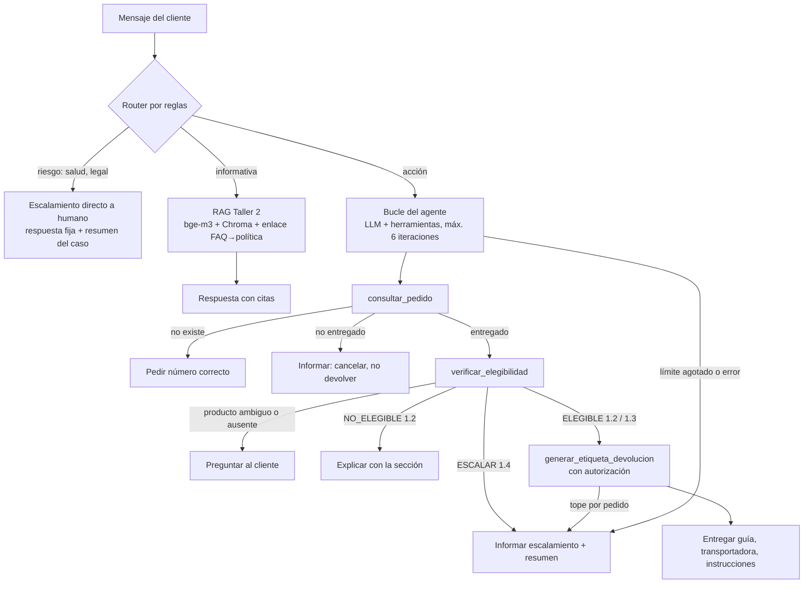

# Fase 1 — Diseño de la arquitectura del agente

## 1. Objetivo y alcance

El asistente de atención al cliente de EcoMarket, construido como sistema RAG en el Taller 2, pasa a ser un agente capaz de ejecutar el proceso de devolución de productos: consultar el pedido, verificar la elegibilidad según la política y generar la etiqueta de transporte. El agente conserva la capacidad de responder preguntas generales con la base de conocimiento y deriva a un agente humano los casos que la política reserva para personas.

Los sistemas externos (pedidos, transportadora) son simulados, como indica el enunciado, con datos diseñados para cubrir todos los casos de la política.

## 2. Extensión de la arquitectura RAG: router y herramienta

El enunciado admite dos formas de incorporar el RAG: como herramienta del agente o como ruta alterna de un router. Se usan las dos, con papeles distintos.

Un **router determinista** clasifica cada mensaje antes de que intervenga un modelo de lenguaje:

| Ruta | Cuándo | Qué la atiende |
|---|---|---|
| `riesgo` | Menciones de salud (sarpullido, alergia, intoxicación), amenaza legal o de exposición pública | Respuesta fija de escalamiento a humano, con resumen del caso. Sin LLM |
| `accion` | Intención en primera persona sobre un pedido o producto (devolver, cambiar, reembolso, cancelar, estado), o un número de pedido | El agente con herramientas |
| `informativa` | Todo lo demás | El RAG del Taller 2 |

La ruta de riesgo corresponde a la sección 1.4 de las políticas (daño a la salud, acción legal) y se resuelve sin modelo, de modo que ningún texto del usuario puede convencer al modelo de atender un caso que debe ver una persona. Resuelve además el caso `val-02` que quedó como limitación del Taller 2: una pregunta de salud que la recuperación semántica enviaba a la guía de cuidado.

Dentro de la ruta de acción, el RAG queda disponible como una herramienta más (`buscar_politicas`), para que el agente pueda consultar una regla que las herramientas deterministas no codifican.

## 3. Herramientas

Cuatro herramientas; el mínimo exigido es dos sin contar el RAG.

| Herramienta | Entrada | Salida | Sistema simulado |
|---|---|---|---|
| `consultar_pedido` | `id_pedido` | Estado, fecha de entrega, días transcurridos, productos (SKU, nombre, categoría, precio). Si el pedido no está entregado, nota de que puede cancelarse (FAQ-09). Si no existe, `encontrado=false` con instrucción | Sistema de pedidos (`datos/pedidos.json`) |
| `verificar_elegibilidad` | `id_pedido`, `producto` (nombre o SKU), `motivo` (opcional), `empaque_abierto`, `devolver_pedido_completo` | Decisión `ELEGIBLE`, `NO_ELEGIBLE` o `ESCALAR`; sección de la política que la sustenta; explicación; valor del reclamo; si es elegible, código de autorización interno y el siguiente paso | Reglas de la política como código (`reglas_devolucion.py`) |
| `generar_etiqueta_devolucion` | `id_pedido`, `sku`, `autorizacion` | Número de guía, transportadora, vigencia, instrucciones. Se niega sin autorización válida o si se supera el tope de etiquetas por pedido | Transportadora |
| `buscar_politicas` | `pregunta` | Fragmentos relevantes con su id, para citar | RAG del Taller 2 (bge-m3 + ChromaDB) |

Tres decisiones de diseño de las herramientas, cada una motivada por un fallo observado en las pruebas (Fase 2):

**El modelo no transporta identificadores que no puede conocer.** `verificar_elegibilidad` acepta el producto por nombre y lo resuelve contra los ítems del pedido de forma determinista. Si el nombre es ambiguo (dos botellas en el mismo pedido), devuelve los candidatos para que el agente pregunte en lugar de adivinar. Si el producto no está en el pedido, devuelve la lista real de productos, para que el agente se corrija en la siguiente iteración.

**La etiqueta exige una autorización que solo emite la verificación.** Es un HMAC sobre pedido, SKU y decisión. El modelo no puede generar etiquetas sin pasar por la política, aunque el usuario se lo ordene; una autorización de otro producto no sirve.

**La política se evalúa sobre el reclamo completo.** La verificación acumula el valor ya autorizado en el mismo pedido y acepta la bandera de devolución completa, de modo que un reclamo de $531.000 no puede fraccionarse en seis reclamos pequeños por debajo del tope de $500.000. La generación de etiquetas tiene además un tope de dos por pedido sin revisión humana.

Las reglas de la política (secciones 1.1 a 1.4 de `corpus/politicas.md`) viven en `reglas_devolucion.py`, con una prueba por regla. Ningún modelo de lenguaje decide si una devolución procede: el modelo orquesta y redacta; la decisión viene de una regla que cita su sección.

## 4. Marco de agentes: LangChain

Se eligió LangChain frente a LlamaIndex por tres razones. La primera es continuidad: el RAG del Taller 2 está construido sobre LangChain 1.x (`langchain-chroma`, `langchain-ollama`), y reutilizarlo como herramienta no exige adaptadores. La segunda es la integración de herramientas: `ChatOllama` y `ChatAnthropic` exponen la misma interfaz `bind_tools`, de modo que el agente puede cambiar de modelo por configuración, y el decorador `@tool` convierte una función Python con su docstring en la definición que el modelo recibe. La tercera es el control: el bucle del agente está escrito a mano (unas cuarenta líneas) en lugar de usar `create_agent`, para que cada paso sea visible, se controle el límite de iteraciones, cada error de herramienta vuelva al modelo como mensaje y todo quede registrado. LlamaIndex ofrece agentes equivalentes y su fortaleza está en la ingestión y los índices de documentos, que aquí ya están resueltos.

## 5. Modelo de lenguaje

El agente corre por defecto con `qwen3:14b` en Ollama, el mismo generador de los Talleres 1 y 2, y acepta un modelo de la API de Anthropic por configuración (`--modelo anthropic:claude-haiku-4-5-20251001`). La decisión se tomó con una prueba previa de tool calling (sección 2 de la Fase 2): tras corregir el diseño de la herramienta, el modelo local decidió, eligió y argumentó correctamente en 6 de 6 casos, igual que el de API. Con el modelo local, ningún dato del cliente sale del equipo y la demostración no depende de conectividad; el modelo de API queda como alternativa medida.

## 6. Flujo de trabajo

Decisiones del agente en el bucle: si el cliente no da número de pedido, pedirlo; si no da motivo, verificar con `otro` sin preguntar, porque el escalamiento y el rechazo no dependen del motivo; preguntar antes de verificar solo cuando el producto es de higiene personal y no se sabe si el empaque está abierto. Un guardarraíl del bucle impide cerrar el turno con una verificación `ELEGIBLE` sin etiqueta, y la sección de política se añade a la respuesta si el modelo omite citarla.

## 7. Manejo de errores

| Situación | Comportamiento |
|---|---|
| Pedido inexistente | La herramienta lo informa; el agente pide verificar el número |
| Producto no está en el pedido o es ambiguo | La herramienta lista los productos o candidatos; el agente se corrige o pregunta |
| Motivo inválido | La herramienta lista los motivos válidos |
| Etiqueta sin autorización, con autorización de otro producto o por encima del tope | La herramienta se niega con un mensaje que el agente transmite |
| Herramienta inexistente o excepción en una herramienta | El error vuelve al modelo como resultado; el turno continúa |
| Límite de iteraciones | Respuesta de derivación a humano con lo ya revisado |
| Error técnico (modelo caído, índice vacío) | Respuesta de derivación a humano; el error queda en el registro |
